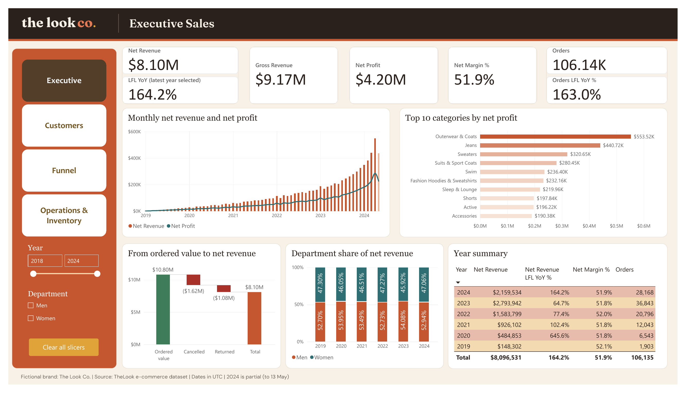
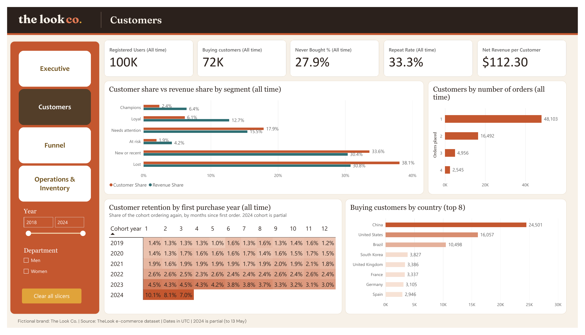
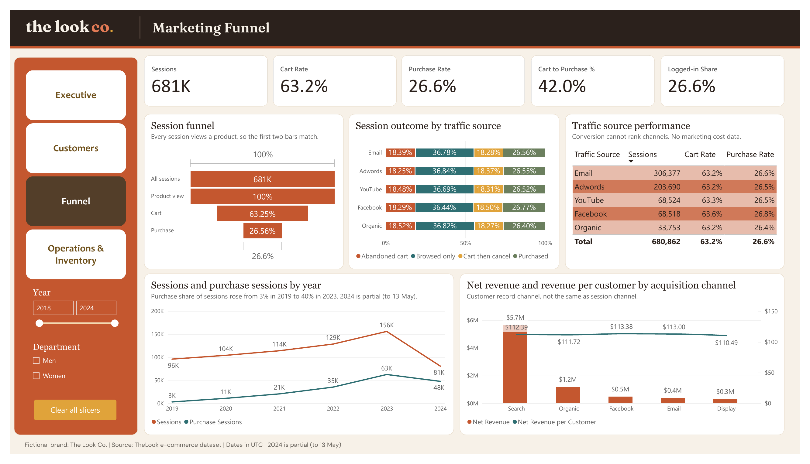
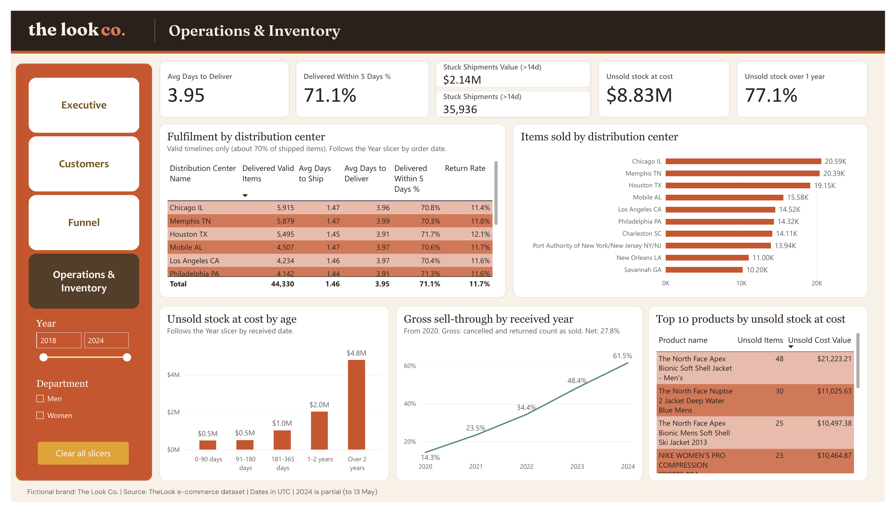
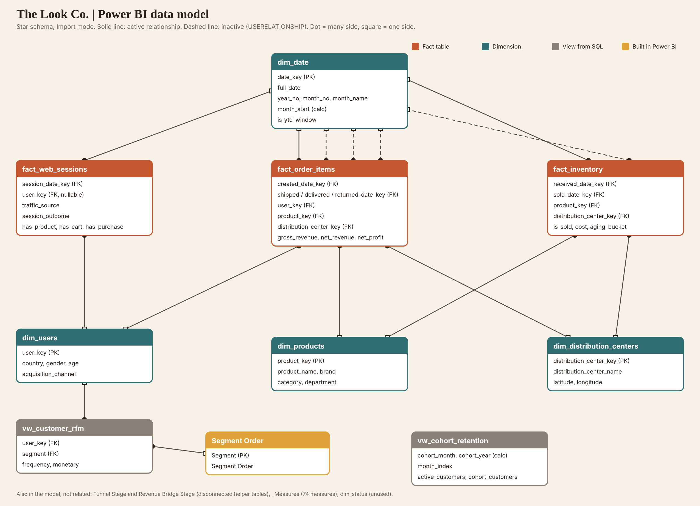

# The Look Co. | E-commerce analytics with SQL Server and Power BI

An end-to-end analytics project on a fictional online clothing retailer: raw tables cleaned and modeled in T-SQL, analyzed with eight query packs, and delivered as a four-page Power BI report. Key figures in the report were reconciled back to SQL (40+ checks, see the QA checklist).

**Start here:** [Report PDF](docs/The_Look_Ecommerce_report.pdf) | [Report file (Releases)](../../releases) | [Findings](docs/analysis_insights.md) | [SQL scripts](sql/README.md) | [Definitions](docs/definitions.md) | [QA checklist](docs/qa_checklist.md)

**Business brief.** The Look Co. is growing quickly but the leadership team has four questions. Is growth healthy and profitable? Who are the customers and do they come back? Where does the web funnel leak? Are fulfilment and stock under control? The report answers one question per page.

**Scale:** 100,000 customers, 180,862 order items, 680,862 web sessions, 488,146 stock items, January 2019 to 13 May 2024.

## What this project shows
- **T-SQL data engineering:** typed clean layer, star schema with keys and constraints, data quality diagnostics, reconciliation checks, reporting views and a stored procedure.
- **Analysis:** growth and margin, returns, cohort retention, RFM segmentation, web funnel, fulfilment, inventory aging and sell-through.
- **Power BI modeling:** star schema with role-playing dates, 74 DAX measures, like-for-like time intelligence for a partial year, helper tables and a fixed segment sort.
- **Report design:** custom theme, left navigation panel, synced slicers and caveats written next to the visuals they affect.
- **Analytical judgement:** the dataset is synthetic and very uniform, so the project states plainly what the data can and cannot support.

## Headline findings
| # | Finding | Evidence | Where |
|---|---|---|---|
| 1 | Growth is strong and accelerating | Net revenue $148k (2019) to $2.79M (2023). Like-for-like (1 Jan to 13 May), 2024 net revenue is $2.16M vs $0.82M, up 164%, and orders are up 163%. The last 13 days of May run unusually high, which may be an artifact of how the data was generated | `sql/04_analysis/01` |
| 2 | Margin is flat | Net margin 51.8% to 52.1% every year. Jeans is the second biggest profit pool with the thinnest category margin (46.5%) | `sql/04_analysis/01`, `02` |
| 3 | Most customers buy once | 66.7% of 72,096 buyers ordered once; 27.9% of registered users never bought | `sql/04_analysis/03` |
| 4 | A small group carries a lot of value | Loyal plus Champions are 8.5% of customers and about 19% of revenue. "At risk" has 1,379 customers and $342k lifetime revenue | `sql/04_analysis/04` |
| 5 | Stock is old | $8.83M of unsold stock at cost; 77.1% ($6.81M) is over a year old and $4.79M over two years | `sql/04_analysis/07` |
| 6 | Possible stuck shipments | 35,936 items (about $2.14M) marked Shipped for more than 14 days, against a normal delivery time of about 4 days | `sql/04_analysis/06` |
| 7 | Channels, centers and categories look the same | Conversion, return rates and delivery times differ only within noise, so volume, price mix, stock and retention are the levers | `sql/04_analysis/05`, `06` |

The full write-up is in [`docs/analysis_insights.md`](docs/analysis_insights.md).

## Recommendations
1. Win back "At risk" customers first, then test a reactivation offer on the 27,460 "Lost" customers.
2. Push the second order with a post-purchase journey for the 48,103 one-time buyers. Moving just 5% of them to a repeat order is about 2,400 orders.
3. Stop buying slow categories and clear stock older than one year.
4. Investigate the shipped-but-not-delivered backlog; either statuses are not being updated or about $2.1M of revenue is at risk.
5. Review Jeans pricing and sourcing.
6. Add marketing cost data before judging channels.

## The report
Page 1 (Executive Sales) is shown at the top. The other three pages:

<table>
<tr>
<td width="33%"> <b>2. Customers</b> Who buys, who comes back, who is slipping away?</td>
<td width="33%"> <b>3. Marketing Funnel</b> How do sessions become purchases, and which channels bring customers?</td>
<td width="33%"> <b>4. Operations and Inventory</b> How fast do we deliver, and how much stock is stranded?</td>
</tr>
</table>

- **Open the report:** download `The_Look_Ecommerce.pbix` (about 84 MB) from the [Releases page](../../releases) and open it in Power BI Desktop. The data is imported, so the file opens without a database connection.
- **No Power BI?** A PDF of all four pages is in [`docs/The_Look_Ecommerce_report.pdf`](docs/The_Look_Ecommerce_report.pdf).

## Data model

One date table drives every fact table. Orders use the created date by default; shipped, delivered and returned dates are inactive relationships activated inside measures with `USERELATIONSHIP`. Details are in [`powerbi/data_model.md`](powerbi/data_model.md) and every measure is listed in [`powerbi/dax_measures.md`](powerbi/dax_measures.md).

## How the numbers were checked
The Power BI model was queried and compared with SQL for more than 40 values (revenue by year, return and cancel rates, segment counts, funnel counts, stock value and more). Every check passes; see [`docs/qa_checklist.md`](docs/qa_checklist.md). Problems found along the way are recorded there too, for example a stuck-shipments measure that counted from midnight instead of the exact last timestamp, and segment shares that all showed 100% until a filter was cleared on the sort helper table.

## Decisions and limitations
- **Partial 2024:** the data stops on 13 May 2024. Year-over-year uses the same 1 January to 13 May window each year, and May 2024 is lightened on the monthly chart.
- **Gross vs net revenue:** gross excludes cancelled items; net also excludes returned items. Net still includes Processing and Shipped items, so it is not "delivered revenue": only $2.73M (34%) of the $8.10M net revenue is in Complete status. Average order value is gross revenue divided by non-cancelled orders ($86.42).
- **Synthetic data:** margin, conversion, delivery time and sell-through are almost identical across channels, centers and categories. That is a property of the data and not a business result.
- **Funnel:** anonymous sessions never buy and logged-in sessions always buy, so purchase rate equals logged-in share. Channels cannot be ranked on conversion, and there is no marketing cost data.
- **Delivery times:** 19.6% of order items have impossible timelines (a ship or delivery date before the order date). They are excluded from delivery-time metrics only.
- **Money columns:** prices and costs are stored as `float`, so totals are compared at two decimals.
- **Customer key:** emails are not unique, so `user_id` is the only customer key.

All data quality findings are in [`docs/data_quality_report.md`](docs/data_quality_report.md); metric definitions are in [`docs/definitions.md`](docs/definitions.md).

## What I would do next
- Add marketing cost data so channels can be judged on return on spend, not just volume.
- Check whether "Shipped" statuses are stale (the $2.14M backlog) against a delivery confirmation source.
- Test the win-back and second-order recommendations with a holdout group before scaling them.

## Run it yourself
1. **Get the data.** The project uses the TheLook e-commerce dataset. I worked from a snapshot ending on 13 May 2024, restored as a SQL Server backup that is not included here (about 1 GB). A different export will end on another date, so the figures will differ.
2. **Load the raw tables** into a SQL Server database named `The_Look_Ecommerce`, schema `dbo`, with the table names listed in [`sql/README.md`](sql/README.md).
3. **Run the scripts** in the order given in [`sql/README.md`](sql/README.md) (clean layer, star schema, reconciliation, analysis, views).
4. **Open the report.** Either use the supplied `.pbix`, or build your own on the `dw` schema following [`powerbi/data_model.md`](powerbi/data_model.md) and [`powerbi/dax_measures.md`](powerbi/dax_measures.md).

## Repository guide
| Folder | Contents |
|---|---|
| `sql/` | Clean layer, profiling, star schema, reconciliation, eight analysis packs, Power BI views, run order |
| `powerbi/` | Data model, all DAX measures, report guide |
| `docs/` | Data quality report, data dictionary, definitions, analysis insights, QA checklist, ERD, screenshots and report PDF |

## Tools
SQL Server (T-SQL, SSMS), Power BI Desktop, DAX.

## About
Built by **Minh Phuc Le** as a portfolio project for Data Analyst roles.

- LinkedIn: [minh-phuc-le-luke](https://www.linkedin.com/in/minh-phuc-le-luke/)
- Email: minhphucle.luke@gmail.com

"The Look Co." is a fictional brand name used for presentation. The code in this repository is released under the MIT license (see `LICENSE`).
